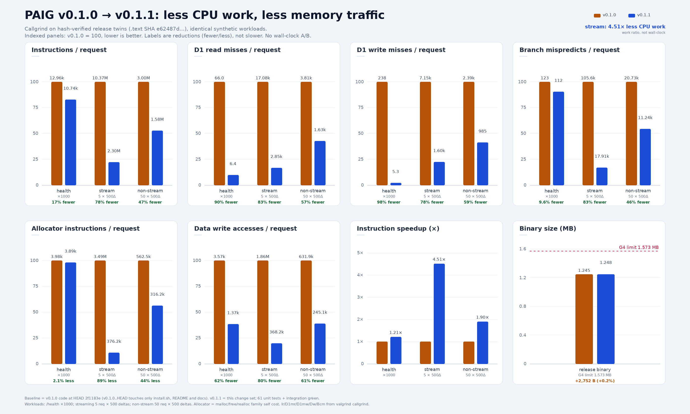

# PAIG - (Probably AI Gateway)

a local gateway that lets OpenAI-shaped clients
reach several model backends through one endpoint. SDKs, CLIs, and agents
point at `http://127.0.0.1:8899/v1`; PAIG picks the backend from the model id
prefix, forwards the request, and normalizes the reply to the OpenAI `/v1`
shape.

## Install

```sh
curl -fsSL https://raw.githubusercontent.com/Angkuh-Org/PAIG/main/install.sh | sh
```

The installer fetches the `x86_64` or `aarch64` release binary, verifies its
SHA-256, and installs `paig` to `~/.local/bin` (or `/usr/local/bin` as root):

```text
  ✔ verify    paig v0.1.1
```

Release binaries need glibc 2.35+. Set `PAIG_INSTALL_DIR` to change the target
directory. If `~/.local/bin` is not on `PATH`, run the `export` line the
installer prints. Manual downloads, checksums, and provenance verification are
in [`docs/install.md`](docs/install.md).

## Build from source

The binary is built from `std` plus raw FFI over vendored Mbed TLS: no cargo,
no crates. TLS and the CA bundle are linked into the binary.

## Requirements

- Linux with glibc
- `rustc` 1.85+ with edition 2024 support
- `cc` and `ar` for the vendored Mbed TLS build 
- POSIX `sh` for `build.sh` and `tests/*.sh`
- A reasonably correct system clock

G2's sanctioned set is `libc` and glibc support libraries (`libm`,
`libpthread`, `libdl`, `librt`, `libgcc_s`). The build gate checks `ldd` after
linking and fails on anything else.

## Quick start

Build the gateway:
```sh
./build.sh                   # rustc + Mbed TLS build -> build/paig
```

Create the config:
```sh
./build/paig --init          # write ~/.paig/config.json
```

`--init` writes `~/.paig/config.json` with mode `0600` and prints the
credential state of every backend. Missing keys do not fail the command: each
backend reads its key from the environment or its `apiKey`/`apiKeyFile` fields
in `config.json`.

Start the server:
```sh
./build/paig                 # serve on 127.0.0.1:8899
```

Send a request:
```sh
curl -s http://127.0.0.1:8899/health
curl -s http://127.0.0.1:8899/v1/models
curl -s http://127.0.0.1:8899/v1/chat/completions \
  -H 'content-type: application/json' \
  -d '{
    "model": "opencode/beam-free",
    "messages": [{"role": "user", "content": "hello"}]
  }'
```

Point any OpenAI SDK at `http://127.0.0.1:8899/v1`. The gateway does not
authenticate inbound requests: keep it on loopback unless an authenticating
proxy sits in front.

Background control (`paig.pid` and `paig.log` live in `~/.paig/`):
```sh
./build/paig --start      # detached start; write ~/.paig/paig.pid, append ~/.paig/paig.log
./build/paig --status
./build/paig --stop
./build/paig --restart
```

## Performance

v0.1.1 cuts per-request JSON/SSE work without changing the wire format.
Callgrind on hash-verified release twins, same synthetic workload:



- streaming: 78% fewer instructions, 4.51× less CPU work
- non-streaming: 47% fewer instructions, 1.90× less CPU work
- health: 17% fewer instructions, 1.21× less CPU work
- D1 write misses on health: 98% fewer; allocator cost on streaming: 89% less
- binary: 1.245 MB → 1.248 MB, still under the 1.5 MiB gate

These are loopback instruction-count ratios, not wall-clock latency. Method and
profiling recipe: [`docs/build.md`](docs/build.md#profiling).

## Model routing

The model prefix selects the backend; the prefix is stripped before the
request is forwarded. First matching prefix wins. Unprefixed ids are rejected
with HTTP 400 (`model_unrouted`); there is no default backend.

| Model id | Backend | Credential |
| --- | --- | --- |
| `opencode/<id>`, `oc/<id>` (also `opencode:<id>`) | OpenCode free | none; uses the public key literal |
| `opencode-go/<id>` | OpenCode Go | `OPENCODE_API_KEY` / `OPENCODE_API_KEY_FILE` / `opencode auth export` |
| `kilo/<id>`, `kilocode/<id>` | Kilo | `KILO_API_KEY` |
| `bob/<id>` | IBM Bob | `PAIG_BOB_API_KEY` / `PAIG_BOB_API_KEY_FILE` |
| `mistral/<id>` | Mistral | `PAIG_MISTRAL_API_KEY` / `PAIG_MISTRAL_API_KEY_FILE` |
| `cc/<id>`, `commandcode/<id>` | Command Code `/alpha/generate` | `CC_API_KEY` (required) |

Examples: `opencode/beam-free`, `opencode-go/iceman-contributor-free`,
`kilo/nvidia/nemotron-3.5-super-vl:free`, `bob/<model>`,
`mistral/mistral-large-4`, `cc/deepseek/deepseek-v4.1-flash`.

## Configuration

Precedence, lowest to highest:
1. built-in defaults
2. `~/.paig/config.json`, then `./paig.config.json`
3. `~/.paig/.env`, then `./.env`
4. process environment

Files in the same layer merge; later files and higher layers win.
`PAIG_CONFIG=<file>` replaces config-file discovery with one file, and
`PAIG_ENV_FILE=<file>` does the same for env-file discovery. Empty string
values for string keys in env files do not erase a value from JSON.

Copy the examples:
```sh
mkdir -p ~/.paig
cp paig.config.example.json ~/.paig/config.json
cp .env.example .env
```

Inspect the result:
```sh
./build/paig --check          # sources, key status, warnings, errors
./build/paig --print          # resolved config; secret values masked
./build/paig --get server.port
./build/paig --init --force   # rewrite ~/.paig/config.json
```

`--check` exits non-zero on validation errors. Config and env files that are
group/world readable produce a `chmod 600` warning.

## Key setup

One import flag covers every backend; the prefix selects it
(`opencode`/`oc`, `kilo`, `bob`, `mistral`, `commandCode`/`cc`):
```sh
./build/paig --init \
  --from-auth opencode:~/.paig/opencode.key \
  --from-auth kilo:~/.paig/kilo.key \
  --from-auth bob:~/.paig/bob.key \
  --from-auth mistral:~/.paig/mistral.key \
  --from-auth cc:~/.paig/cc.key
```

Key files accept JSON (`apiKey`/`api_key`/`key`/`token`) or a bare key, and
`~` is expanded. Imported keys land in the matching `apiKey` field of
`~/.paig/config.json`.

`--init` writes only keys passed with `--from-auth`; keys from each backend's
env var or `apiKey`/`apiKeyFile` in `config.json` apply at runtime and are not
written. `apiKey` wins if both are set.

## SSE and response shape

- `"stream": true` returns `text/event-stream` with chunked transfer,
  `cache-control: no-cache, no-transform`, and `x-accel-buffering: no`.
- Every backend streams OpenAI `chat.completion.chunk` frames; Command Code's
  CLI stream is translated, OpenAI-shaped backends pass through as-is.
- Non-streaming requests return one `chat.completion` object with the `model`
  field restored to the id the caller sent.
- Errors use `{"error":{"message":...,"type":...,"code":...}}`; upstream
  failures keep their HTTP status where possible. A mid-stream failure emits
  an OpenAI error frame and closes the stream.

Passthrough backends preserve unknown request fields.

## Environment variables

| Variable | Default | Purpose |
| --- | --- | --- |
| `PAIG_HOST` | `127.0.0.1` | Bind address (G6: loopback by default) |
| `PAIG_PORT` | `8899` | Bind port, 1-65535 |
| `PAIG_DEBUG` | `0` | Verbose request logging |
| `PAIG_ADVISOR_MAX_BYTES` | `1000000` | Trim oversized advisor transcripts |
| `PAIG_LEDGER` | `~/.paig/paig-ledger.jsonl` | JSONL usage ledger, mode `0600` |
| `CC_API_KEY` | empty | Command Code key; required for `cc/` and `commandcode/` models |
| `CC_API_KEY_FILE` | empty | JSON or plain-text key file |
| `CC_MODELS` | unset | Comma list of bare ids; used when the live catalogue is unavailable |
| `PAIG_EXCLUDED_MODELS` | built-in list | Replaces the exclusion list; empty disables |
| `CC_FETCH_RETRIES` | `2` | Retries for transient upstream failures |
| `CC_FETCH_BACKOFF_MS` | `500` | Linear backoff base |
| `CC_USER_AGENT` | `cli` | `user-agent` identity header |
| `CC_CLI_VERSION` | `1.88.0` | `x-command-code-version` header |
| `CC_CLI_ENVIRONMENT` | `production` | `x-cli-environment` header |
| `CC_TASTE_LEARNING` | `true` | `x-taste-learning` header |
| `OPENCODE_API_KEY` | empty | OpenCode Go credential |
| `OPENCODE_API_KEY_FILE` | empty | OpenCode key file |
| `OPENCODE_BIN` | empty | CLI used for `auth export`; falls back to `~/.opencode/bin/opencode` |
| `OPENCODE_MODELS` | built-in free list | Comma list of free model ids |
| `OPENCODE_GO_MODELS` | built-in Go list | Comma list of Go model ids |
| `OPENCODE_TIMEOUT_MS` | `180000` | OpenCode upstream timeout |
| `KILO_API_KEY` | empty | Kilo credential |
| `KILO_ALL_MODELS` | `0` | Expose every model the gateway reports |
| `PAIG_BOB_API_KEY` | empty | Bob credential |
| `PAIG_BOB_API_KEY_FILE` | empty | Bob key file, e.g. `~/.paig/bob.key` |
| `PAIG_BOB_TEAM_ID` | empty | Bob team id |
| `PAIG_BOB_USER_AGENT` | `bob-shell/2.0.9` | Bob user agent |
| `PAIG_MISTRAL_API_KEY` | empty | Mistral credential |
| `PAIG_MISTRAL_API_KEY_FILE` | empty | Mistral key file, e.g. `~/.paig/mistral.key` |
| `PAIG_MISTRAL_MODELS` | unset | Curated ids; unset lists every chat model |
| `PAIG_CONFIG` | unset | Use one config file instead of discovery |
| `PAIG_ENV_FILE` | unset | Use one env file instead of discovery |

## CLI

```text
paig                                   run the server
paig --init [--force] [--from-auth [backend:]file]  create ~/.paig/config.json
paig --print                           print resolved config (secrets masked)
paig --check                           validate config and show sources
paig --get <dotted.key>                print one resolved value
paig --rules                           print the game rulebook
paig --start                           start in the background (pid/log in ~/.paig/)
paig --stop                            stop the background server
paig --restart                         stop, then start in the background
paig --status                          report running / not running (exit 1 when not running)
```

`--init` refuses to overwrite an existing config unless `--force` is given;
with `--force` it keeps existing values and fills in missing ones. The file is
written atomically with mode `0600`, and missing credentials are reported per
backend without failing the command.

## Development

Build flags, `build.sh` commands, tests, and benchmark: [docs/build.md](docs/build.md).
Rules G1-G7 and the scorecard: [docs/rules.md](docs/rules.md).

## License

GPL-3.0-only. Bundled third-party components: Mbed TLS 3.6.7 (Apache-2.0 OR
GPL-2.0-or-later) and the Mozilla CA bundle converted by curl.se (MPL-2.0).
See `vendor/mbedtls/LICENSE`, `vendor/mbedtls/ca-bundle.LICENSE`, and
`vendor/mbedtls/README.paig.md`.
